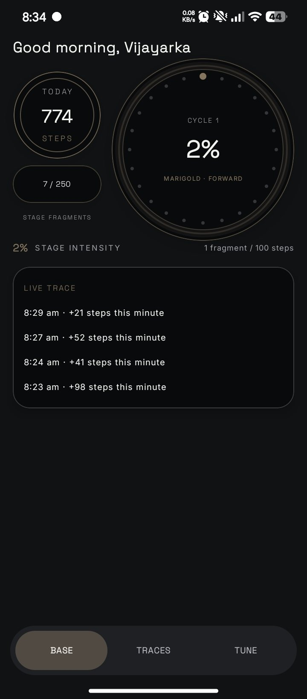
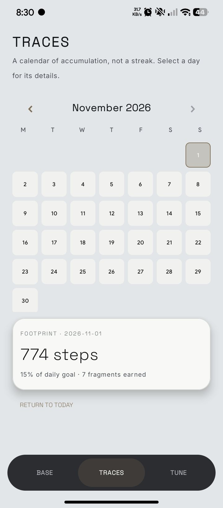
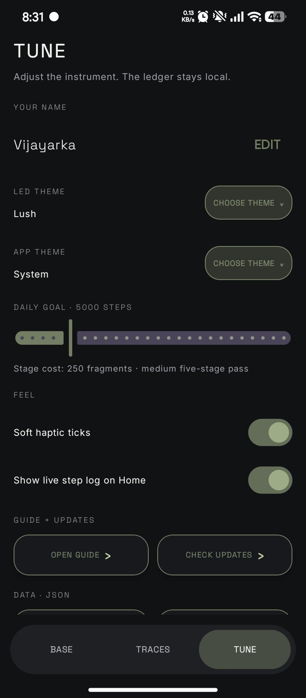
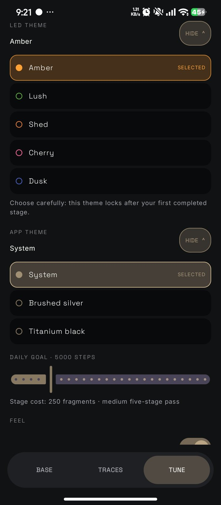

<div align="center">


# Metabasis

### A step instrument that changes as you move.

A private, offline-first Android step instrument. Your steps become fragments, fragments move through stages, and the dashboard evolves without an account or a noisy feed.

[](LICENSE)
[](https://github.com/vijayarkananduri/metabasis/releases)
[](#quiet-by-design)
[](#quiet-by-design)
[](https://github.com/vijayarkananduri/metabasis)

[**Get the APK**](https://github.com/vijayarkananduri/metabasis/releases) · [**Read the guide**](https://vijayarkananduri.github.io/metabasis/metabasis-guide.html) · [**Website**](https://vijayarkananduri.github.io/metabasis/)
</div>

---

## Why Metabasis?

Most step counters turn movement into a number, a streak, or another feed to maintain. Metabasis treats it as a quiet visual journey instead: count locally, keep the record, and let the instrument change gradually as you move.

No account. No ads. No Health Connect dependency. No internet permission.

## See it

<div align="center">

| Base | Traces | Tune | Themes |
|:---:|:---:|:---:|:---:|
|  |  |  |  |

</div>

## Everything it does

**Base.** See today’s steps, the cycle ring, stage fragments and a live trace of recent minutes.

**Traces.** Browse a calendar of accumulation, not a streak. Select a day for its footprint.

**Tune.** Choose your name, one of five LED themes (Amber, Lush, Shed, Cherry or Dusk), app theme, daily goal, feel, guide, releases and local JSON data tools.

**Fragments and stages.** Every 100 new steps earns a fragment. 250 fragments fill a stage, and five stages form a pass.

**Private by design.** Counts and history stay on your device. Export and import your local JSON history whenever you need a backup or restore.

## The instrument in three ideas

| Idea | What it means |
|---|---|
| Count locally | Uses the phone’s own motion sensors without an account or Health Connect. |
| Move through stages | Each 100 new steps earns a fragment; five stages form a pass. |
| Keep your data | Settings and history remain in app-private storage and can be exported as local JSON. |

## Quiet by design

Metabasis stores settings and history in app-private storage. It does not ask you to create an account, use analytics or ad SDKs, need Health Connect, or request internet permission.

| Promise | What to expect |
|---|---|
| **No account** | Open the app and start with your local device. |
| **No internet permission** | Your step history is not sent to a server by the app. |
| **No Health Connect dependency** | Metabasis reads the phone’s own motion sensors directly. |
| **Local backup** | Export and import your history as JSON from Tune. |

## Get Metabasis

Free and open source.

1. Open [**Releases**](https://github.com/vijayarkananduri/metabasis/releases) and download the latest debug APK.
2. Android may show a warning because debug builds can be unsigned.
3. Grant **Physical activity** when the app asks, then set your goal and open Base.

The full walkthrough is in the [**Metabasis Guide**](https://vijayarkananduri.github.io/metabasis/metabasis-guide.html).

## Build from source

Open the repository in Android Studio with JDK 17 and Android SDK 35, then run the `app` configuration on Android 8.0+ (API 26).

```bash
git clone https://github.com/vijayarkananduri/metabasis.git
cd metabasis
./gradlew :app:assembleDebug
```

Every push to `main`, pull request, or manual workflow run builds an Android debug APK in GitHub Actions. A `v*` tag also attaches the debug APK to a GitHub Release.

## Design notes

Metabasis is part of the Alive UI approach: keep structure trustworthy and let light, texture and context change slowly. The [step-counter design review](docs/step-counter-design.md) explains the sensor choices and the trade-offs around background collection.

## Contribute

Issues, ideas and pull requests are welcome.

1. Fork the repo.
2. Create a branch: `git checkout -b feature/my-idea`.
3. Make your change and run the relevant checks.
4. Open a pull request.

## License

[MIT](LICENSE). Use it, change it, share it.

---

<div align="center">

[Website](https://vijayarkananduri.github.io/metabasis/) · [Guide](https://vijayarkananduri.github.io/metabasis/metabasis-guide.html) · [Source](https://github.com/vijayarkananduri/metabasis) · [Releases](https://github.com/vijayarkananduri/metabasis/releases)

© 2026 Vijayarka Nanduri. Released under the MIT license.

</div>
